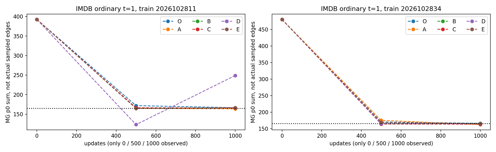
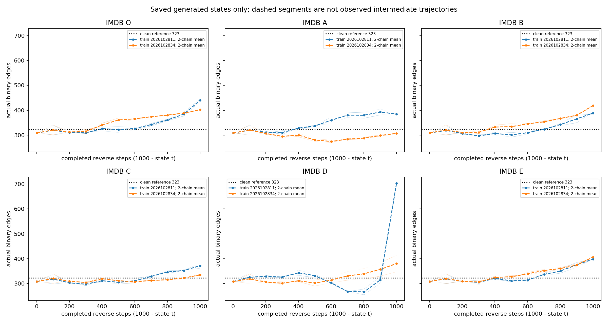
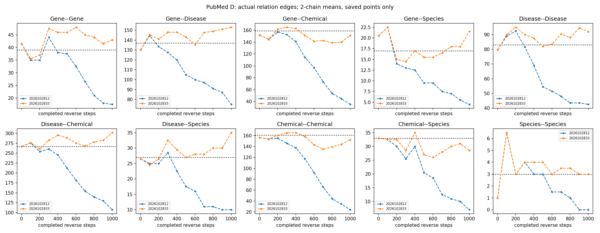
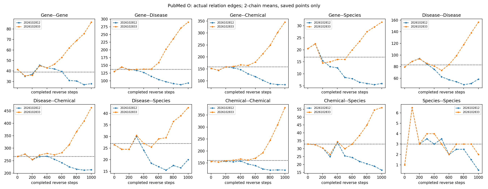
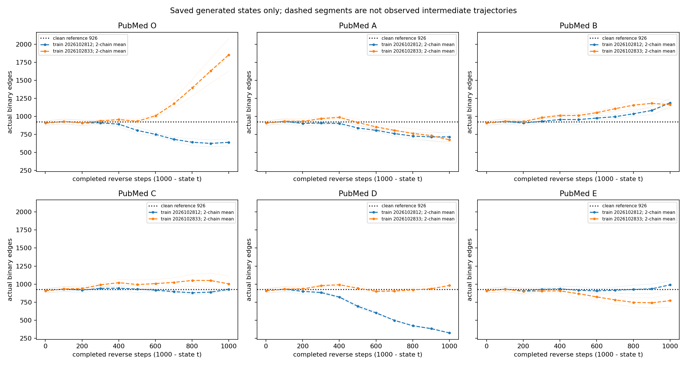

# 完整面板索引

p0列均来自1000更新固定普通噪声验证；末图列是两条已有自由生成链实际边数均值。不同来源并列描述，不拼接为因果轨迹。

|数据集|训练seed|组|t=1 CE / p0和|t=500 CE / p0和|t=1000 CE / p0和|末图实际边数均值|
|---|---:|---|---:|---:|---:|---:|
|IMDB|2026102811|O|0.000548 / 325.11|0.042375 / 305.46|0.067565 / 275.89|440.0|
|IMDB|2026102834|O|0.000760 / 324.76|0.046686 / 399.13|0.068154 / 346.30|402.5|
|IMDB|2026102811|A|0.000475 / 322.20|0.038848 / 306.86|0.067312 / 305.35|384.5|
|IMDB|2026102834|A|0.000614 / 321.81|0.043873 / 267.52|0.068505 / 285.39|307.0|
|IMDB|2026102811|B|0.000647 / 324.28|0.042620 / 280.56|0.067423 / 285.96|388.5|
|IMDB|2026102834|B|0.000703 / 325.52|0.045951 / 351.89|0.068350 / 334.54|418.5|
|IMDB|2026102811|C|0.000734 / 319.10|0.042486 / 314.13|0.067267 / 307.17|372.0|
|IMDB|2026102834|C|0.001274 / 321.14|0.049971 / 315.89|0.067684 / 335.93|335.0|
|IMDB|2026102811|D|0.009675 / 409.16|0.046741 / 336.01|0.070362 / 452.03|703.0|
|IMDB|2026102834|D|0.000496 / 324.32|0.043316 / 284.00|0.068442 / 294.95|380.5|
|IMDB|2026102811|E|0.000643 / 323.80|0.039300 / 295.92|0.067272 / 308.93|398.0|
|IMDB|2026102834|E|0.000755 / 325.00|0.043549 / 333.01|0.068319 / 325.73|406.5|
|PubMed|2026102812|O|0.001603 / 925.00|0.110739 / 760.08|0.198429 / 907.04|640.5|
|PubMed|2026102833|O|0.001720 / 939.01|0.109637 / 1082.97|0.199444 / 947.87|1854.5|
|PubMed|2026102812|A|0.001058 / 928.14|0.106448 / 818.97|0.198192 / 906.08|716.0|
|PubMed|2026102833|A|0.001956 / 918.23|0.110803 / 910.26|0.201462 / 926.82|675.0|
|PubMed|2026102812|B|0.001447 / 938.15|0.105743 / 977.19|0.198228 / 885.80|1188.5|
|PubMed|2026102833|B|0.001731 / 926.78|0.108306 / 1047.51|0.200237 / 1006.58|1161.0|
|PubMed|2026102812|C|0.001348 / 933.15|0.106421 / 938.86|0.198147 / 955.92|927.0|
|PubMed|2026102833|C|0.001578 / 918.76|0.108444 / 998.69|0.200344 / 991.56|1002.5|
|PubMed|2026102812|D|0.001827 / 924.54|0.112267 / 707.90|0.198565 / 916.27|322.5|
|PubMed|2026102833|D|0.001876 / 924.25|0.112627 / 793.62|0.201372 / 1012.29|981.5|
|PubMed|2026102812|E|0.001221 / 932.78|0.106621 / 977.93|0.198204 / 898.45|990.0|
|PubMed|2026102833|E|0.001366 / 928.31|0.109900 / 804.98|0.200550 / 846.40|770.5|

所有0/500/1000更新、三噪声时刻的总表：[validation_total.csv](validation_total.csv)；分关系和正/负CE：[validation_relations.csv](validation_relations.csv)。

完整生成状态总表：[trajectory_total.csv](trajectory_total.csv)；分关系表：[trajectory_relations.csv](trajectory_relations.csv)。

## 已保存状态曲线

